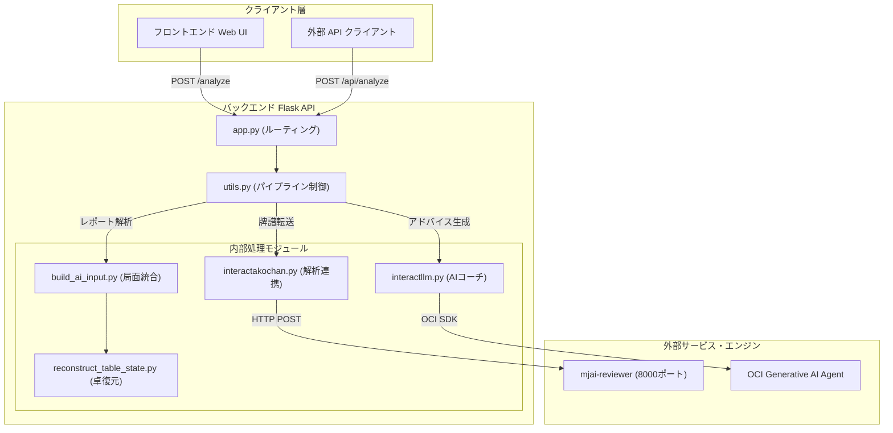
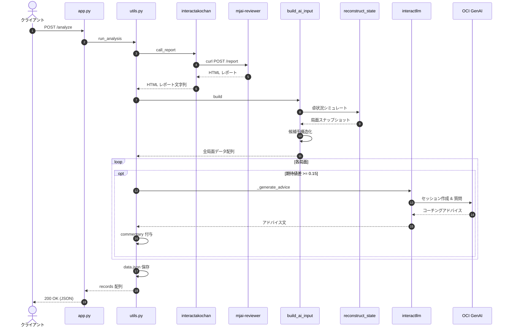

# Mahjong-Coaching2 バックエンド — 詳細仕様書

## 1. プロジェクト概要

本プロジェクトは、麻雀AI「Akochan」（`mjai-reviewer`）の解析エンジンと連携し、ユーザーの麻雀牌譜（天鳳ログURL、JSON、レポートファイル）から**全局・全局面の完全な卓状況（河・副露・手牌・他家手牌・ドラ・点数など）およびAI評価値候補**を復元・抽出し、損失期待値（Loss）の大きい局面に対して **OCI (Oracle Cloud Infrastructure) の Generative AI Agent** によるコーチングアドバイスを付与した構造化 JSON を提供するバックエンド API サーバーです。

フロントエンド（`Mahjong-Coaching_FrontEnd` v2）の入力仕様（`ai-input-format`）に完全準拠しており、フロントエンドおよび外部クライアントへの高精度な検討データ提供を行います。



---

## 2. ディレクトリ・ファイル構成

```
Mahjong-Coaching2/
├── .gitignore                      # Git 除外設定（__pycache__, data.json など）
├── README.md                       # プロジェクト概要および起動手順書
├── docs/                           # 仕様書ドキュメント格納フォルダ
│   ├── code_detail.md              # 本詳細仕様書（Markdown 版）
│   ├── code_detail.pdf             # 本詳細仕様書（PDF 版）
│   ├── code_detail.html            # 仕様書 HTML プレビュー
│   └── generate_pdf.py             # PDF 自動生成スクリプト
└── backend/
    ├── app.py                      # Flask アプリケーション本体（API ルーティング）
    ├── utils.py                    # 処理オーケストレーション（解析・LLM 付与）
    ├── build_ai_input.py           # レポート HTML から新仕様 JSON への統合モジュール
    ├── build_report.py             # 新仕様 JSON から画面用ビューモデルへの変換モジュール
    ├── reconstruct_table_state.py  # 天鳳ログから卓状況（河・副露・手牌）の復元モジュール
    ├── interactakochan.py          # Akochan サーバー連携モジュール（curl 経由）
    ├── interactllm.py              # OCI Generative AI Agent 連携モジュール
    ├── prompt.txt                  # AI コーチ向けプロンプトテンプレート
    ├── requirements.txt            # Python 依存パッケージ定義
    ├── test_app.py                 # 単体テスト・スキーマ検証スクリプト
    ├── source/                     # サンプル・テスト用ファイル
    │   ├── replay.json             # テスト用牌譜 JSON
    │   ├── test.json               # テスト用 JSON
    │   └── test_report.html        # テスト用 Akochan レポート HTML
    └── templates/                  # ブラウザ直接アクセス用テンプレート
        ├── index.html              # 入力フォーム画面（Mahjong-Coaching_FrontEnd v2）
        ├── result_manyhands.html   # 新仕様対応 牌譜検討結果画面（他家の河・副露・AI助言対応）
        ├── result.html             # 解析結果画面（互換エイリアス）
        └── error.html              # エラー表示画面（400 / 404 / 500対応）
```

---

## 3. エンドツーエンド処理シーケンス



---

## 4. 各モジュール詳細設計

### 4.1 `app.py` — Flask API エントリーポイント

HTTP リクエストのハンドリング、パラメータ抽出・バリデーション、レスポンス形式の制御を行います。

#### ルート一覧

| メソッド | パス | 関数 | 概要 |
|---|---|---|---|
| `GET` | `/` | `index()` | 牌譜入力フォーム画面（HTML）を表示 |
| `POST` / `GET` | `/analyze` | `analyze()` | 牌譜解析メインエンドポイント（JSON / HTML 返却） |
| `POST` / `GET` | `/api/analyze` | `api_analyze()` | API 専用エンドポイント（JSON 返却） |
| `GET` / `POST` | `/error` | `error()` | 500 エラーテスト用エンドポイント |

#### パラメータ判定ロジック (`_execute_analysis()`)

1. **`seat`（プレイヤー席番号）**:
   - `request.form` → `request.args` の順で取得（デフォルト: `"0"`）。
   - `0`〜`3` 以外は即座に `400 Bad Request`（`jsonify(error=...)`）を返却。
2. **`source_type`（データ種別）**:
   - 明示指定がない場合、以下の優先順位で自動判定：
     1. クエリパラメータ `url` が存在 → `"url"`
     2. `input_data` が `http://` または `https://` で開始 → `"url"`
     3. `input_data` が入力されている → `"json"`
     4. リクエストにファイルが添付されている → `"file"`
     5. リクエストが JSON (`request.is_json`) → `"json"`
     6. いずれも該当しない場合 → `400 Bad Request`
3. **`format`（レスポンス形式）**:
   - デフォルトは `"json"`。
   - `format=html` が指定された場合のみ、ブラウザ向けに `render_template("result.html")` をレンダリング。
   - それ以外はすべて `jsonify(records)`（`Content-Type: application/json`）を返却。

---

### 4.2 `utils.py` — 解析オーケストレーション

Akochan 呼び出し、データ構築、LLM アドバイス付与、一時ファイル管理を一括制御します。

#### 定数
- `EV_DIFF_THRESHOLD = 0.15`: アドバイス生成の閾値。AI 推奨手とプレイヤーの選択の期待値差（`loss`）がこの値以上の局面のみ LLM に問い合わせを行います。

#### 主要関数

##### `run_analysis(source_type, seat, url, file_content, json_body, generate_advice=True)`
- **引数**:
  - `source_type`: `"url"`, `"file"`, `"json"` のいずれか
  - `seat`: 対象プレイヤーの席番号（0〜3）
  - `url`, `file_content`, `json_body`: ソースデータ
  - `generate_advice`: LLM アドバイス生成を行うフラグ（デフォルト: `True`）
- **処理フロー**:
  1. `interactakochan.call_report()` を実行して HTML レポートを取得（file/json の場合は一時ファイルを作成）。
  2. `build_ai_input.build(report_html, viewer=seat)` を実行し、局面オブジェクトの配列（`records`）を生成。
  3. `generate_advice=True` の場合、各局面の `loss` をチェックし、`abs(loss) >= 0.15` の局面に対して `interactllm._generate_advice(rec)` を呼び出し、戻り値を `rec["commentary"]` に代入。
  4. 生成された `records` をローカルの `data.json` に書き出し（確認用）。
  5. `finally` 句で一時ファイルを確実に削除。

---

### 4.3 `build_ai_input.py` — 局面データ統合モジュール

Akochan レポート HTML をパースし、各局面の評価値・候補手表と、`reconstruct_table_state.py` で復元した卓状況を統合して `ai-input-format` 仕様の完全な JSON を構築します。

#### 主要ロジック

1. **`build(html, viewer=None)`**:
   - HTML を BeautifulSoup（`lxml` パーサー）で解析。
   - メタデータ欄から `player id`（デフォルト: `viewer` または 0）と `AI engine` 名を取得。
   - レポート内の各局ブロック（`report_groups`）と、埋め込み天鳳 JSON（`load_kyoku_logs`）の局数が一致することを検証。
   - 局ごとに `reconstruct_table_state.simulate()` を呼び出し、全巡目のスナップショット（手牌・河・副露）を生成。
   - HTML 内の `details.entry`（各局面）とスナップショットを突き合わせ、以下の整合性チェックを実施：
     - **手牌照合**: 復元手牌とレポート表示手牌が完全一致するか
     - **副露照合**: 復元副露とレポート表示副露が完全一致するか
     - **AI手照合**: 候補手テーブルの第1行目と AI 推奨行動が一致するか
2. **`parse_action(s, ctx)`**:
   - 文字列表記の行動（`Discard [2m]`, `Discard Riichi [4s]`, `[c] [c] Pon, cut [9s]`, `Kan [w]` 等）を構造化オブジェクトに変換。
   - カンの場合、文脈（`trigger` が `draw` か `opponent_discard` か、既にポンしているか）に応じて `daiminkan` / `kakan` / `ankan` を自動判別。
3. **`entry_raw(entry)`**:
   - `details.entry` のテーブルから、プレイヤー行動、AI 行動、および全候補手（行動名、期待値 `pt_ev`、放銃率 `deal_in_pct`、放銃時期待値 `post_deal_in_pt_ev`、通過時期待値 `tile_passes_pt_ev`）をパース。

---

### 4.4 `reconstruct_table_state.py` — 卓状況・手牌復元エンジン

HTML レポート内の `<textarea>` に含まれる天鳳形式 JSON ログ（`tenhou.net/6 JSON log`）を再生（シミュレーション）し、実戦中の卓状況を完全に復元します。

#### 復元対象
- **4家の手牌**: 配牌からツモ・打牌・鳴きをトレースした手牌（実戦中非公開の他家手牌 `hidden_info.hands` を含む）。
- **4家の河**: 各家の捨て牌履歴。ツモ切り（`tsumogiri`）、立直宣言牌（`riichi`）、鳴かれた牌と鳴き元の相対席（`called_by_rel`）を属性として記録。
- **副露（鳴き）**: チー、ポン、大明槓、加槓、暗槓。鳴いた牌、出し元の相対位置（`上家`/`対面`/`下家`）を管理。加槓では元のポンに4枚目を追加。
- **ドラ表示牌・点数・供託**: カンドラの追加表示、立直棒の供託状況、持ち点の推移を追跡。

#### 座標系・相対位置
自家の席（`viewer`: 0〜3）を基準とし、他家を常に以下の相対位置で扱います：
- `0`: `self`（自分）
- `1`: `shimocha`（下家: `(viewer + 1) % 4`）
- `2`: `toimen`（対面: `(viewer + 2) % 4`）
- `3`: `kamicha`（上家: `(viewer + 3) % 4`）

---

### 4.5 `interactakochan.py` — Akochan サーバー連携モジュール

外部で稼働している `mjai-reviewer` サーバー（デフォルト: `http://localhost:8000/report`）へ `curl` コマンドを通じて解析リクエストを送信します。

- `_build_curl_command(source_type, source, seat, endpoint)`:
  - `source_type="url"`: `-G --data-urlencode url=...`
  - `source_type="file"`: `-F file=@...`
  - `source_type="json"`: `-H "Content-Type: application/json" --data-binary @...`
- `_run_command(cmd)`: `subprocess.run` で実行し、標準出力を UTF-8 文字列として取得。エラー時は標準エラー出力を含めて `RuntimeError` を送出。

---

### 4.6 `interactllm.py` — OCI Generative AI Agent 連携モジュール

OCI (Oracle Cloud Infrastructure) の Generative AI Agent Runtime SDK を利用し、プロンプトに基づいてアドバイステキストを生成します。

#### フェイルセーフ設計
ローカル開発環境やテスト環境など、OCI の認証情報が存在しない場合でもサーバー全体が落ちないよう多層のフォールバック機構を備えています：
1. `oci.auth.signers.InstancePrincipalsSecurityTokenSigner()`（OCI クラウドインスタンス上での実行時認証）を試行。
2. 失敗した場合、ローカルの `~/.oci/config`（CLI 認証プロファイル）の読み込みを試行。
3. いずれの認証も失敗した場合は例外をキャッチし、ログに警告（`logger.warning`）を出力した上で `None` を返却（`commentary: null` として安全に継続）。

#### プロンプト入力データフォーマット
新形式の局面レコード（`rec`）から以下の変数を抽出・整形して `prompt.txt` のテンプレートに流し込みます：
- `{kyoku}`: 局名（例: `"東1局"`）
- `{turn}`: 巡目（例: `8`）
- `{tehai}`: 手牌一覧（例: `"1m 2m 2m 3m 4m 3s 4s 5s 8s 9s e w c 8m"`）
- `{ai_discard}`: AI推奨手（例: `"打 e"`）
- `{ai_ev}`: AI手の期待値（例: `-0.87562`）
- `{player_discard}`: プレイヤーの選択手（例: `"打 w"`）
- `{player_ev}`: プレイヤー選択の期待値（例: `-0.90394`）

---

### 4.7 `test_app.py` — 単体テストスイート

`unittest` をベースにした自動テストモジュール。モックを使用して Akochan / OCI の実環境に依存せずに高速にテスト可能です。

- `test_invalid_seat`: 不正な席番号（例: `seat=5`）に対して HTTP 400 が返ることを検証。
- `test_empty_request`: 入力データが空の場合に HTTP 400 が返ることを検証。
- `test_successful_analysis_json_format`: 実サンプル HTML レポート（`test_report.html`）を入力とし、`POST /analyze` が 200 OK で新仕様の全フィールド（`meta`, `situation`, `self`, `others`, `hidden_info`, `decision`, `commentary`）を含む JSON 配列を返すことを検証。

---

## 5. データスキーマ仕様 (`ai-input-format`)

本 API が出力する JSON は、局・半荘全体の局面オブジェクトを配列とした `list[dict]` 構造です。

```json
[
  {
    "meta": {
      "engine": "Akochan",
      "kyoku": "東1局",
      "honba": 0,
      "kyotaku": 0,
      "dora_indicators": ["e"]
    },
    "situation": {
      "turn": 1,
      "wall_remaining": 69,
      "trigger": "draw",
      "trigger_actor": "自分",
      "trigger_tile": "8m"
    },
    "self": {
      "wind": "east",
      "is_dealer": true,
      "score": 25000,
      "hand_with_trigger_tile": [
        "1m", "2m", "2m", "3m", "4m", "3s", "4s", "5s", "8s", "9s", "e", "w", "c", "8m"
      ],
      "melds": [],
      "river": [
        {
          "tile": "w",
          "tsumogiri": false,
          "riichi": false,
          "called_by": null
        }
      ]
    },
    "others": {
      "shimocha": {
        "wind": "south",
        "is_dealer": false,
        "score": 25000,
        "river": [],
        "melds": [],
        "riichi": false,
        "genbutsu": []
      },
      "toimen": { "..." : "..." },
      "kamicha": { "..." : "..." }
    },
    "hidden_info": {
      "note": "牌譜から復元した他家の手牌。実戦中は見えない情報。助言の根拠にする場合は『結果から見ると』と明示すること。",
      "hands": {
        "shimocha": ["3m", "4s", "6m", "7m", "7p", "7p", "8s", "9p", "c", "e", "f", "n", "p"],
        "toimen": ["1s", "2s", "3p", "4m", "4m", "4p", "5sr", "6m", "7s", "9p", "9p", "s", "s"],
        "kamicha": ["1m", "2p", "2p", "3p", "3s", "4p", "7m", "7s", "8p", "8s", "9m", "n", "w"]
      }
    },
    "decision": {
      "player_choice": {
        "type": "discard",
        "tile": "w"
      },
      "ai_choice": {
        "type": "discard",
        "tile": "e"
      },
      "loss": 0.02832,
      "player_pt_ev": -0.90394,
      "ai_pt_ev": -0.87562,
      "candidates": [
        {
          "action": { "type": "discard", "tile": "e" },
          "pt_ev": -0.87562,
          "deal_in_pct": 0.00034,
          "post_deal_in_pt_ev": -32.16042,
          "tile_passes_pt_ev": -0.87551
        },
        {
          "action": { "type": "discard", "tile": "w" },
          "pt_ev": -0.90394,
          "deal_in_pct": 0.00034,
          "post_deal_in_pt_ev": -32.16042,
          "tile_passes_pt_ev": -0.90383
        }
      ]
    },
    "commentary": "（loss >= 0.15 の局面に付与されるアドバイス文。それ以外は null）"
  }
]
```

### 牌表記一覧 (mjai 準拠)
- 萬子: `1m`〜`9m`（赤5: `5mr`）
- 筒子: `1p`〜`9p`（赤5: `5pr`）
- 索子: `1s`〜`9s`（赤5: `5sr`）
- 字牌: `e`（東）, `s`（南）, `w`（西）, `n`（北）, `p`（白）, `f`（發）, `c`（中）

---

## 6. エラーハンドリング仕様

| HTTP ステータス | 発生条件 | レスポンス形式 |
|---|---|---|
| **400 Bad Request** | `seat` が 0〜3 以外、入力データが空、URL 形式の不正 | `{"error": "エラー詳細メッセージ"}` |
| **404 Not Found** | 存在しないエンドポイントへのリクエスト | HTML エラーページ |
| **500 Internal Server Error** | 解析エンジン（Akochan）の通信失敗、パース不整合 | `{"error": "エラー詳細メッセージ"}` （HTMLモード時は `error.html`） |

---

## 7. 環境要件とセットアップ

### 前提環境
- Python: 3.10 以上
- OS: Linux / macOS / Windows
- 外部依存: `curl` コマンド、`mjai-reviewer`（ポート 8000 で起動）

### 起動・テストコマンド
```bash
# 依存ライブラリのインストール
pip install -r backend/requirements.txt

# 単体テストの実行
python backend/test_app.py

# サーバー起動 (デフォルト: 0.0.0.0:8080)
python backend/app.py
```
